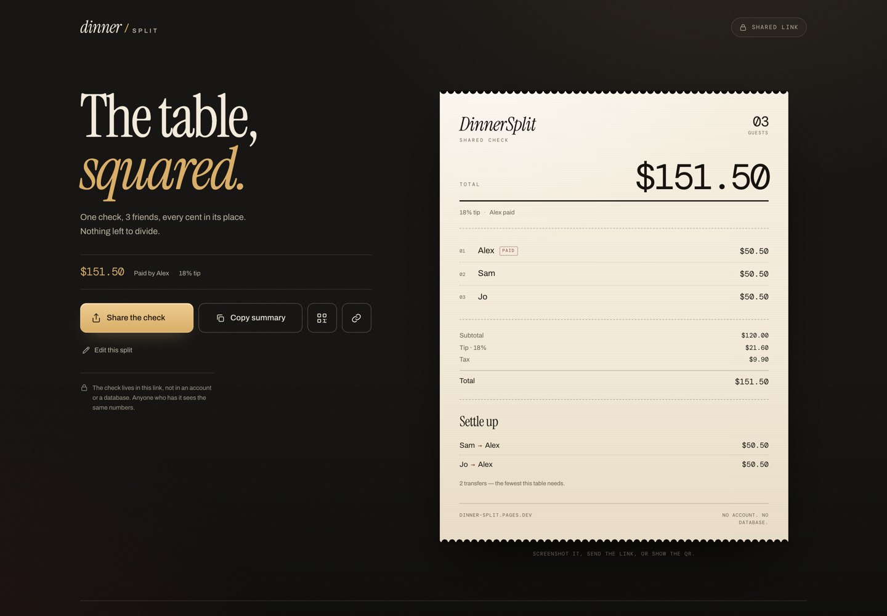

# DinnerSplit

Split one restaurant check fairly, on a phone, in under a minute. No account, no database: the entire check travels inside a single shareable link.

**Live:** https://dinner-split.pages.dev  
Built as a static React app for **Cloudflare Pages free tier**.

## Preview



## What it does

- Add 2–12 people by name.
- Enter the bill as one total, or item by item.
- Add tip and tax (percentage or amount); tip is calculated on the subtotal.
- Split equally, by custom final amounts, by percentage, or by item (shared items included).
- Choose who paid; the result lists each share and the fewest transfers needed to settle.
- Every cent is allocated exactly — no lost or invented pennies.
- Share the full check as a link, a QR code, or copied text.
- The result is a letterpress-style check that is easy to screenshot.

## Stack

- React 19 + TypeScript + Vite
- No backend, no database, no analytics
- `lz-string` for compressed URL state
- `qrcode.react` for QR codes
- Self-hosted Instrument Serif, Archivo, and DM Mono (Fontsource)
- Cloudflare Pages, direct static upload

## Local development

```bash
npm install
npm run dev
```

Open http://127.0.0.1:5173.

```bash
npm test        # 22 unit tests for money, splitting, rounding, and transfers
npm run build   # typecheck + production build into dist/
npm run preview # serve the production build
```

## How state works

The whole document is one `SplitState` object:

```ts
{
  version: 1,
  people, mode, bill, tipPct, tipCustom, tax, taxMode,
  items, split, custom, percents, payer
}
```

- The result URL is `/s/<payload>`.
- `<payload>` is `lz-string` compressed JSON, then `+` is swapped for `.` so the path is safe everywhere.
- `/s/*` is rewritten to `index.html` by `public/_redirects`; no Functions or server runtime are needed.
- The builder can be reopened from a result with **Edit this split** (`/?d=<payload>`).
- There is no localStorage, cookie, or server-side bill storage.

## Deploy to Cloudflare Pages

Requires a Cloudflare account with Pages access.

```bash
npx wrangler login
npm run deploy
```

`npm run deploy` builds `dist/` and uploads it with:

```bash
wrangler pages deploy dist --project-name dinner-split
```

Project settings live in `wrangler.jsonc`. The first deploy creates the Pages project; the production URL will be:

```
https://dinner-split.pages.dev
```

If that project name is taken on your account, change `name` in `wrangler.jsonc` and the `--project-name` in the deploy script.

### Hosting files

- `public/_redirects` — SPA fallback for `/s/*`
- `public/_headers` — CSP, frame denial, referrer policy, long-lived asset caching
- `public/og.png` — social card
- `public/favicon.svg`, `public/apple-touch-icon.png`

## Correctness notes

- All money is integer cents.
- Equal, percentage, and itemized allocations use the largest-remainder method so shares sum exactly to the total.
- Shared items are divided among their assignees with the same method.
- Tip and tax are allocated proportionally to each person's item subtotal.
- Transfers use an exact zero-sum-partition search (2^12 states) to minimise the number of payments for a table of up to 12.
- If no payer is chosen, shares are shown without transfers.
- Custom amounts and percentages must add up to the final total / 100%; the app explains the remainder and offers **Split evenly**.

## Limitations (MVP)

- USD formatting only (the requirement explicitly leaves currency conversion out of scope).
- No OCR, accounts, payment deep links, saved history, or offline PWA.
- Image/PDF export is not included; the check is designed to be screenshotted.
